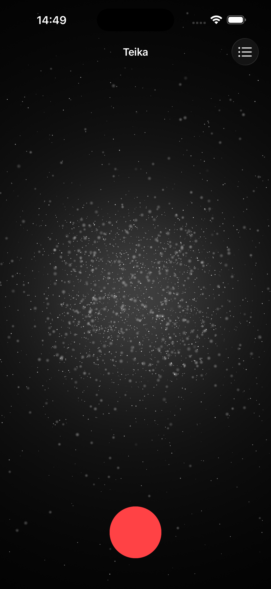
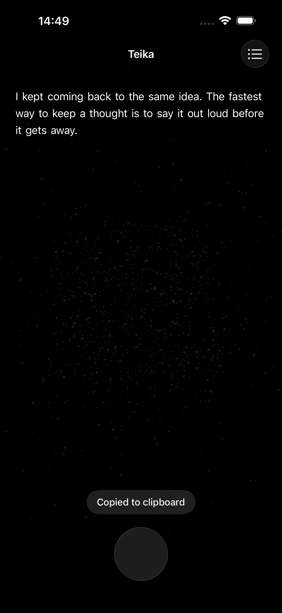
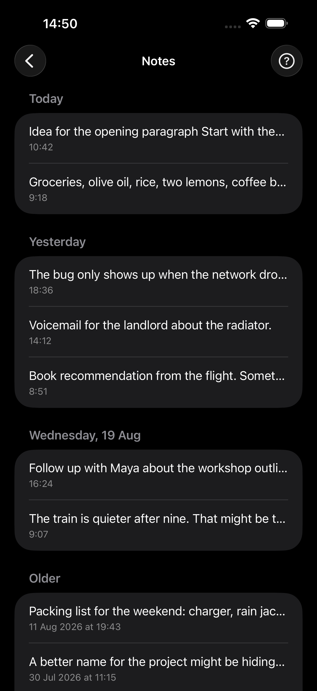

# Teika — catch the thought before it is gone

Teika is a free and open-source speech-to-text notes app for iPhone and Apple
Watch. Tap the circle, speak for as long as you need, then tap again. The
transcription is copied to your clipboard and saved in a searchable local
library.

## How it works

1. **Start from what is closest.** Open Teika from the app, Apple Watch, a
   widget, Control Center, Shortcuts or Siri.
2. **Talk until you are done.** Pausing to think does not end the recording.
3. **Paste it now or find it later.** Each transcription goes to the clipboard
   and the on-device notes library. Open a saved note to select text or make
   edits. Changes save automatically.

## Task app integration

Open **Notes → Settings** (the gear icon) and choose **Apple Reminders** or
**Things** under **Add notes to**. It defaults to **Off**.

For **Apple Reminders**, allow access, choose a writable **List**, and select
**No date** or **Today** (the default). Teika initially selects the system’s
default reminder list. Reminders are created without leaving Teika. Today uses
an all-day due date at delivery; Teika adds no explicit alarm.

For **Things**, choose **Inbox** or **Today** (the default). Things must be
installed on the same iPhone or iPad; **Get Things** links to its website.
It opens briefly to create each task, then returns to Teika. Things may ask
you to enable Things URLs the first time; no Shortcuts setup or token is needed.

Each task uses the note’s short title and transcript. Things’ 10,000-character
notes limit requires an explicitly marked excerpt for longer transcripts;
Reminders receives the full transcript. The complete note stays in Teika.
Text that fits in the title isn’t repeated in the task’s notes; any remaining
lines are included. Truncated titles keep the transcript in the notes, subject to
Things’ limit.
Existing notes aren’t exported. Editing or deleting a note later does not change
its task.

Watch notes received in the background wait until Teika is active and no
recording or transcription is underway. Deliveries run one at a time, oldest
first. Switching apps affects new notes; waiting notes keep their original app.
Destination, list, and scheduling changes apply to waiting deliveries for that
app. **Off** pauses all waiting exports and excludes notes saved while off.

A failed delivery pauses the queue until **Retry** or **Skip this note**. If
Reminders access is denied or revoked, use **Open Settings**. If a list becomes
unavailable, choose another list before retrying; Teika never silently redirects
it. Unconfirmed deliveries are never automatically resent: check the task app
before retrying, since a task might already exist.

Exported text is handed directly to the selected app on your device. It may then
sync through the account associated with your Reminders list or Things Cloud.

## Privacy

Speech recognition runs on the iPhone. Teika does not upload recordings,
transcripts or notes, and it has no account, subscription, ads or in-app
analytics. After you approve a one-time model download of about 0.5 GB from
Hugging Face, transcription works offline.

After setup, Apple Watch recordings can be queued while the iPhone is unavailable
and are transferred through Apple's WatchConnectivity service for local
transcription when the connection returns. See the full
[privacy policy](PRIVACY.md) for details.

## Screenshots

| Record a thought | Review a captured note | Browse all notes |
| --- | --- | --- |
|  |  |  |

## Installation

[Download Teika from the App Store](https://apps.apple.com/app/id6796609245), or
build it from source.

### Requirements

- An iPhone or iPad running iOS 26.5 or later
- watchOS 26.0 or later for the companion Apple Watch app
- Xcode with the iOS 26.5 and watchOS 26 SDKs
- [XcodeGen](https://github.com/yonaskolb/XcodeGen)

### Run the app

`run.sh` generates the Xcode project, lets you choose an available simulator or
device, builds Teika and launches it:

```sh
./run.sh
```

You can also pass a destination directly:

```sh
./run.sh app "iPhone 17 Pro"
```

Simulator builds need no signing configuration. For a physical device, provide
your Apple Developer Team ID locally:

```sh
TEIKA_DEVELOPMENT_TEAM=YOUR_TEAM_ID ./run.sh app "Your iPhone"
```

The same script can create a signed App Store archive or archive and upload it
directly to App Store Connect. Both paths are also available from the picker
shown by `./run.sh`:

```sh
TEIKA_DEVELOPMENT_TEAM=YOUR_TEAM_ID ./run.sh archive
TEIKA_DEVELOPMENT_TEAM=YOUR_TEAM_ID ./run.sh upload
```

The upload path uses the Apple Developer account signed into Xcode and preserves
the version and build number declared in `project.yml`.

### Track changes and release an update

Record meaningful work in [`changes.md`](changes.md) as it is implemented. The
release workflow writes notes from those entries, updates the site, uploads Teika,
fills App Store metadata and submits for review with automatic release after approval.

```sh
./run.sh changes
./run.sh release doctor
./run.sh release prepare --dry-run
```

See [the release workflow](docs/releases.md) for preparation, screenshot capture,
publishing, validation reuse, and recovery. Preparing tooling or running a dry run
does not publish an app release.

### Run the tests

Generate the project, then select a simulator installed on your Mac:

```sh
xcodegen generate
xcodebuild test \
  -project Teika.xcodeproj \
  -scheme Teika \
  -destination 'platform=iOS Simulator,name=iPhone 17 Pro'
```

The live model-download UI test is skipped by default because it downloads about
0.5 GB. Set `RUN_MODEL_DOWNLOAD_TEST=YES` only when you intend to exercise it.

The task export queue, URL, migration, and note persistence tests can also run directly
on macOS without an iOS simulator:

```sh
bash tests/test_things_exports.sh
```

These checks use the app’s actual SwiftData/export sources and fake Things and Reminders adapters.
They do not replace testing both integrations on an iPhone.

### Run the website

The marketing, support and privacy site is a static Next.js export in `site/`:

```sh
./run.sh site          # development server
./run.sh site build    # production export
./run.sh site preview  # build and serve the export
```

## Acknowledgements

- Speech recognition uses
  [NVIDIA Parakeet TDT 0.6B v3](https://huggingface.co/nvidia/parakeet-tdt-0.6b-v3)
  through [FluidAudio](https://github.com/FluidInference/FluidAudio).
- Debug controls use [DialKit](https://github.com/mikelikesdesign/dialkit-ios).
- Third-party license notices bundled with the app are in
  [`teika/LICENSES.txt`](teika/LICENSES.txt).

## License

Teika is licensed under the GNU General Public License v3.0 or later, with an
additional permission for distribution through the Apple App Store. See
[LICENSE](LICENSE).
